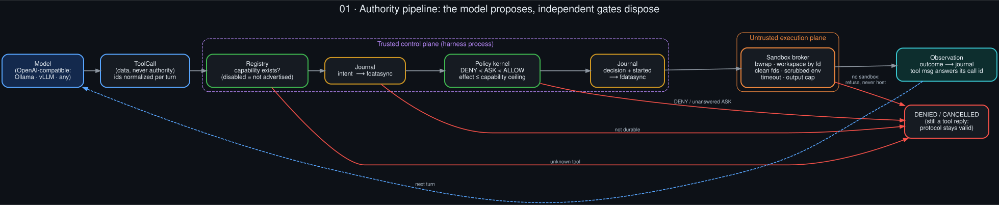
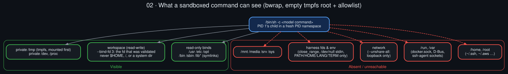
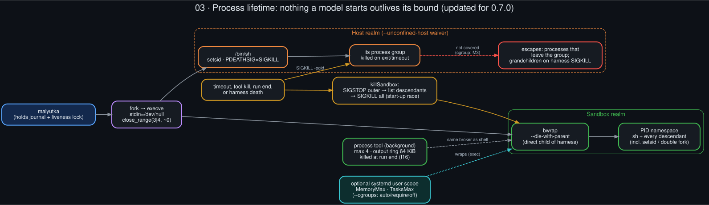
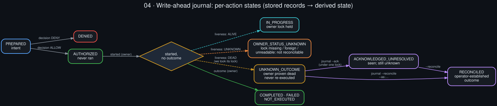
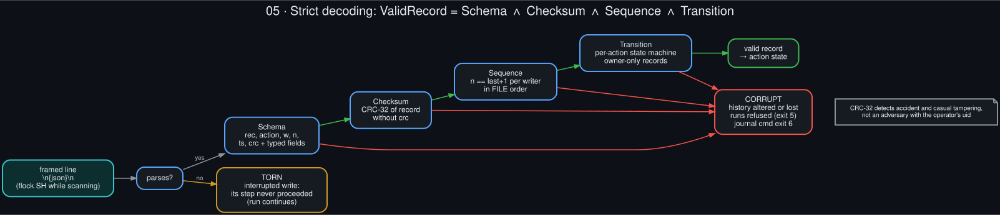
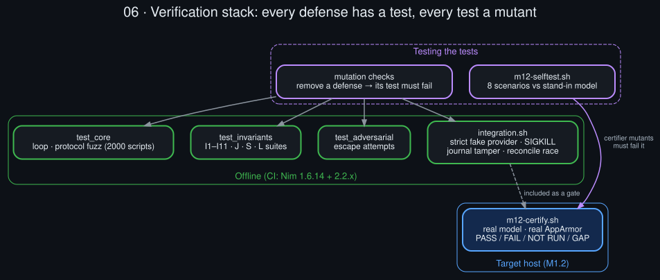
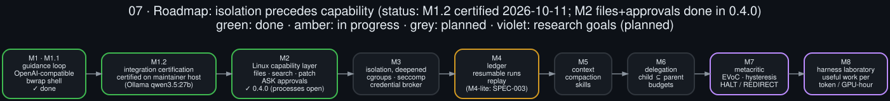

# MALYUTKA // 9M14


[](https://github.com/danindiana/malyutka/actions/workflows/ci.yml)
[](LICENSE)
[](#compiler-support)
[](#requirements)
[](#the-sandbox)
[](CHANGELOG.md)
[-3fb950)](#project-status)

**A small, Linux-native, model-neutral agent harness written in Nim, built so
that a recoverable model mistake cannot become an unrecoverable systems
mistake.**

> Small kernel. Replaceable edges. **Model proposes; policy disposes.**

Malyutka runs the agent loop (model → tool call → observation → model) and
puts every step a model takes through independent gates:

1. a **capability registry**: tools that are off do not exist, even in the
   model's context;
2. a **write-ahead journal**: nothing with side effects runs before its intent
   is on disk;
3. a **policy kernel**: deny always dominates allow;
4. a **bubblewrap sandbox**: the model's shell sees an empty filesystem plus an
   allowlist, no network, no host sockets, no secrets.

It speaks the OpenAI-compatible chat API, so the same harness drives Ollama,
vLLM or any compatible server. Holding the harness constant while the model
varies is the point: it is a substrate for measuring how much of an agent's
behaviour comes from the model and how much from the control system around it.

The name and the green/amber terminal themes are visual identity only (see
[Name](#name)).

---

## Contents

- [Project status](#project-status)
- [Quick start](#quick-start)
- [Requirements](#requirements)
- [Usage](#usage)
- [Architecture](#architecture)
- [The sandbox](#the-sandbox)
- [The journal](#the-journal)
- [Security model and limits](#security-model-and-limits)
- [Testing and certification](#testing-and-certification)
- [Compiler support](#compiler-support)
- [Repository layout](#repository-layout)
- [Roadmap](#roadmap)
- [Contributing](#contributing)
- [Name](#name)
- [License](#license)

---

## Project status

Design docs: [`docs/`](docs/README.md) (Hermes gap analysis, diagrams) · specs: [`spec/`](spec/README.md) · future work: [`todo/`](todo/README.md).

**v0.3.4: M1 (guidance loop) complete; M1.2 (integration certification)
certified on the maintainer's host (2026-10-11, Ollama `qwen3.5:27b`); vLLM and
Ubuntu 24.04's AppArmor configuration still uncertified.**

| Evidence | Status |
|---|---|
| Offline suites: 80 unit/invariant/adversarial + 17 CLI integration, as root and unprivileged | pass (Nim 1.6.14) |
| Native Nim 2.x build and tests | pass on CI (Nim 2.2.x, ubuntu-24.04, unprivileged runner) |
| Nim 2.2.4 semantic check (`nim check`) | 0 diagnostics in Malyutka sources |
| Live Ollama tool-call round trips on a real host | pass: `m12-report-20261011-232806` (Ubuntu 22.04.5, Nim 2.2.12, bwrap 0.6.1, 0 failures) |
| Live vLLM tool-call round trips | **pending**: optional suite not configured in that run |
| bubblewrap under Ubuntu 24.04's real AppArmor configuration | **pending**: the certified run had `apparmor_restrict_unprivileged_userns=0` |

Malyutka is early-stage research software. Its *defenses* are tested
adversarially, and each test is checked by deliberately breaking the defense
it covers. Its *capabilities* are deliberately minimal: today the model has
`echo` and a sandboxed `shell`. Richer tools (M2) wait until isolation and
integration are certified.

---

## Quick start

```sh
# Toolchain (Ubuntu 24.04's apt nim is 1.6.14, which is supported)
sudo apt install nim bubblewrap

git clone https://github.com/danindiana/malyutka.git
cd malyutka
nimble build -y
./malyutka doctor          # must report "sandbox: bwrap OK" before using --allow-shell

# Offline demo: scripted mock provider, no model needed
./malyutka run 'say hello'

# Against a local Ollama model
ollama pull qwen3.5:latest
./malyutka run --provider:ollama --model:qwen3.5:latest 'Summarize what a harness is.'

# Give the model a sandboxed shell in the current directory
./malyutka run --provider:ollama --model:qwen3.5:latest --allow-shell \
  'List the files here and tell me which is largest.'
```

The console view in the default `warsaw` theme (an illustrative run):

```
+--------------------------------------------------------------+
| MALYUTKA // 9M14                         GUIDANCE : READY    |
| LINUX NATIVE AGENT HARNESS               LINK     : LOCAL    |
+--------------------------------------------------------------+
  PROVIDER  ollama
  MODEL     qwen3.5:latest
  SHELL     SANDBOX (bwrap)
  MODE      WARSAW
+--------------------------------------------------------------+
  0001 RUN   9M14-6ad179ef  tools=["echo","shell"]
  0002 STEP  #0
  0003 ACT   shell {"command":"ls -la"}
  0004 POL   [ALLOW] B2  default: no layer objected
  0005 OBS   shell  exit=0
  0006 STEP  #1
  0007 DONE  The largest file is …
```

---

## Requirements

- **Linux** with unprivileged user namespaces (for bubblewrap).
- **Nim ≥ 1.6.14**. CI tests 1.6.14 and 2.2.x.
- **bubblewrap**, for `--allow-shell`. Malyutka refuses to run a sandboxed
  shell it cannot confine (exit 3); it never falls back to the host.
- **python3**, only for the test suites' fake servers.

### Ubuntu 24.04 and AppArmor

Ubuntu 24.04 can restrict unprivileged user namespaces through AppArmor,
which blocks bubblewrap. `./malyutka doctor` runs the exact sandbox used for
tools and tells you whether it works. If it reports the sandbox unavailable,
there are two options:

- **Preferred:** an AppArmor profile that grants `userns` to
  `/usr/bin/bwrap` only.
- **System-wide:** `sudo sysctl -w kernel.apparmor_restrict_unprivileged_userns=0`.
  This is simpler, but it relaxes a hardening measure for every program,
  which is fine on a disposable CI runner (as this repository's CI does) and
  a real tradeoff on a workstation.

---

## Usage

```
malyutka run [options] <task>
malyutka doctor
malyutka journal                     Journal health + actions with unknown outcome
malyutka journal --reconcile:ID --as:completed|failed|not-executed
malyutka journal --ack:ID            Mark it seen, outcome still unknown
```

| Option | Meaning |
|---|---|
| `--provider:mock\|openai\|ollama\|vllm` | provider adapter; all but `mock` speak the OpenAI-compatible chat API |
| `--model:NAME` | model identifier |
| `--base-url:URL` | e.g. `http://127.0.0.1:11434` (Ollama) or `http://127.0.0.1:8000` (vLLM) |
| `--api-key:KEY` | prefer the `MALYUTKA_API_KEY` environment variable |
| `--allow-shell` | enable the **sandboxed** shell capability |
| `--unconfined-host` | **waiver**: run the shell on the host, unsandboxed (logged as `confinement.waived`) |
| `--shell-timeout:SEC` | per-command wall clock (default 30) |
| `--max-steps:N` | guidance-loop budget (default 16) |
| `--repeat-limit:N` | halt after N identical consecutive tool calls (default 3; 0 = off) |
| `--request-timeout:SEC` | provider request timeout (default 300) |
| `--theme:warsaw\|nato\|plain` | console theme: green phosphor, amber, or no colour |
| `--json` | canonical JSONL events on stdout (for replay and metrics) |
| `--config:PATH` | JSON config file (see `config.example.json`) |

**Environment:** `MALYUTKA_PROVIDER`, `MALYUTKA_MODEL`, `MALYUTKA_BASE_URL`,
`MALYUTKA_API_KEY`, and `MALYUTKA_STATE_DIR` (journal and sessions; default
`~/.local/state/malyutka`, and it must not overlap the workspace).

**Exit codes:**

| Code | Meaning |
|---|---|
| 0 | answered |
| 1 | failure (e.g. provider error) |
| 2 | usage |
| 3 | confinement unavailable: sandbox missing or blocked, or an unsafe workspace such as `$HOME` |
| 4 | halted: `maxSteps` or repetition |
| 5 | journal unavailable, misplaced or corrupt (`run`); unknown outcomes pending (`journal`) |
| 6 | journal corrupt (`journal`) |

### Examples

```sh
# vLLM or any OpenAI-compatible server
export MALYUTKA_API_KEY=...
./malyutka run --provider:vllm --base-url:http://127.0.0.1:8000 --model:my-model 'task'

# Machine-readable trace for replay and metrics
./malyutka run --json --provider:ollama --model:qwen3.5:latest 'task' > trace.jsonl

# Configuration file
cp config.example.json my.json && ./malyutka run --config:my.json 'task'
```

Every event carries a run-scoped, monotone ID (`9M14-xxxxxxxx-NNNN`).
Decisions and results carry `causedBy` links, so every side effect can be
traced to the proposal and the decision that allowed it.

---

## Architecture



Four separate questions are answered by four separate components. No single
gate confers authority.

| Question | Answered by |
|---|---|
| Does this capability exist? | the **registry**, built from configuration |
| How bad could this call be? | the capability's **realm** and effect class B0–B4 |
| Is the intent durable? | the **write-ahead journal** |
| May it run? | the **policy kernel**: `DENY < ASK < ALLOW`, effect ≤ ceiling, every decision names its policy |
| Where does it run? | the **sandbox broker** |

The effect of a sandboxed shell command is classified **B2** (broad workspace
mutation) because the sandbox makes B3 and B4 *unreachable*, not because a
parser inspected the command. Command classification can refine a decision
between ALLOW and ASK. It is never what prevents escalation.

Every proposed tool call receives exactly one terminal reply: a result,
DENIED, or CANCELLED. Strict OpenAI-compatible servers reject anything else,
and a 2000-script fuzzer checks the state machine.

See **[ARCHITECTURE.md](ARCHITECTURE.md)** for the full design, the invariant
table, and each correction made along the way.

---

## The sandbox



**Mounts.** A model-issued command runs in bubblewrap with an **empty tmpfs
root** and only these mounted:

- `/usr /etc /opt /bin /sbin /lib*`, read-only;
- private `/tmp`, `/dev`, `/proc`;
- the workspace, read-write.

**Isolation.**

- **Workspace bound by fd.** The workspace is bound from a file descriptor
  that was opened and validated, so a symlink swapped in after the check
  cannot redirect the mount.
- **No network:** all namespaces are unshared.
- **No host sockets:** `/run` and `/home` are absent, so `docker.sock`, D-Bus
  and agent sockets are unreachable.
- **No inherited fds:** `close_range` runs between fork and exec, and stdin
  is `/dev/null`.
- **No secrets in the environment:** only `PATH`, `HOME`, `LANG` and `TERM`
  pass through.



**Lifetime.** bwrap is a direct child of the harness with
`--die-with-parent`, inside its own PID namespace. Nothing the model starts,
including deliberately detached processes, outlives the command, its timeout,
or the harness itself. This holds even if the harness is SIGKILLed; that case
is tested.

---

## The journal



Every side-effecting action is journaled **before** it runs:

```
intent → decision → started → (execute) → outcome
```

Each record is `fdatasync`ed before the next step proceeds. If a record cannot
be made durable, the action does not run. If Malyutka dies mid-action, the
action is **UNKNOWN_OUTCOME**. It is surfaced on every later run and **never
re-executed**, until you establish what happened:

```sh
./malyutka journal                                  # health + pending actions
./malyutka journal --reconcile:9M14-… --as:failed   # you established the outcome
./malyutka journal --ack:9M14-…                     # seen; still unknown
```

**Liveness.** Each run holds a lock that the kernel releases when the process
dies, even on SIGKILL.
- An action whose run is still alive is IN_PROGRESS.
- If its owner's status cannot be established it is OWNER_STATUS_UNKNOWN,
  never assumed dead.
- Neither can be acknowledged or reconciled.



**Integrity.** Reading the journal is strict: a record counts only if its
schema, CRC-32, per-writer sequence number and per-action state transition
are all valid.
- A line that does not parse is a *torn* write from a crash. That is benign:
  the step it guarded never proceeded.
- A record that parses but fails a check is **corruption**. Runs are refused
  until you inspect it.

**Location.** The journal lives outside every workspace, where the sandbox
cannot see it, so the agent cannot rewrite its own record.

---

## Security model and limits

The claims, and what falsifies them, are in **[SECURITY.md](SECURITY.md)**.
In short, Malyutka limits what an instruction the model was tricked into
following *can do*; it does not try to detect prompt injection. Known limits,
stated rather than hidden:

- **`--unconfined-host` is a waiver**, not a mode: full user authority.
  Processes that deliberately leave the process group can outlive their
  command (cgroups: M3).
- **CRC-32 detects accident and casual tampering**, not an adversary running
  as your uid.
- **Workspace contents are visible to the model**, and so to the provider.
  `/etc` is readable.
- **A released lock proves the Malyutka process ended**, not that an action's
  external effects stopped. This is exactly why interrupted actions are
  UNKNOWN_OUTCOME.

---

## Testing and certification



```sh
nimble test                          # unit, invariant and adversarial suites
tests/integration.sh ./malyutka      # CLI: strict provider, SIGKILL, journal tamper, races
```

- **`tests/test_invariants.nim`** names its tests after the architectural
  invariants they pin (I1–I11), plus the journal suites (J, S, L).
- **`tests/test_adversarial.nim`** is a set of escape attempts: reading
  `~/.ssh`, connecting to host sockets, symlink and hard-link tricks,
  inherited fds, swapping the workspace path after the check, and surviving
  timeouts or the harness's death.
- **`tests/integration.sh`** drives the real CLI. A strict fake provider
  rejects protocol violations the way vLLM does, the harness is SIGKILLed
  mid-command, the journal is tampered with, and six operators race to
  reconcile one action.

**Mutation testing.** Each defense was removed in turn to confirm that its
test fails. The few mutants that survive are documented in `ARCHITECTURE.md`
with the reason.

**M1.2 certification** runs on the target host, as an ordinary user:

```sh
M12_MODEL=qwen3.5:27b tests/m12-certify.sh
```

It checks the native build and suites, the sandbox under the host's real
AppArmor configuration, live tool-call round trips, a model-issued escape
attempt, and SIGKILL plus restart of a live run. The result is a dated report
in which each check is **PASS**, **FAIL**, **NOT RUN** (a gate that wasn't
exercised) or **GAP** (live coverage missing, with offline evidence applying).

`tests/m12-selftest.sh` tests the certifier itself against a stand-in model
across eight scenarios with known verdicts.

---

## Compiler support

| Nim | How tested |
|---|---|
| 1.6.14 | full build and all suites, locally (root and unprivileged) and in CI |
| 2.2.x | CI: native build, sandbox probe, all suites and CLI integration pass; also a semantic `nim check` with zero diagnostics |

Malyutka deliberately avoids `std/random` and `std/oids` in its own code.
Nim-version notes are in `ARCHITECTURE.md`.

---

## Repository layout

```
src/malyutka.nim            CLI
src/malyutka/
  core.nim                  guidance loop, transcript validator
  provider.nim              provider ABI, scripted mock, OpenAI-compatible adapter
  tools.nim                 capability registry (realm, effect ceiling, schema)
  policy.nim                policy kernel (monotonic layer composition)
  sandbox.nim               bubblewrap broker, fd-pinned workspace, bounded spawn
  journal.nim               write-ahead journal, strict decoder, liveness
  events.nim                canonical JSONL events + themed console view
  session.nim, config.nim, types.nim
tests/                      suites, fake providers, certification scripts
tools/release.sh            source release builder (refuses binaries)
docs/diagrams/              .dot sources + rendered .svg/.png (render.sh)
ARCHITECTURE.md             design, invariants, corrections
SECURITY.md                 claims, limits, reporting
CHANGELOG.md                every release, every audit finding
```

---

## Roadmap



| Milestone | Scope |
|---|---|
| **M1 / M1.1** ✓ | guidance loop, OpenAI-compatible providers, confined shell, journal |
| **M1.2** | integration certification on a real host (in progress) |
| M2 | Linux capability layer: files, search, patch, bounded processes, ASK approvals |
| M3 | isolation, deepened: per-capability scopes, cgroups, seccomp, credential broker |
| M4 | ledger: resumable runs, content-addressed artifacts, replay |
| M5 | context: token accounting, compaction, skills |
| M6 | delegation: isolated children with `capabilities(child) ⊆ capabilities(parent)` and budgets |
| M7 | metacritic: replace `maxSteps` with an EVoC/hysteresis controller (PRODUCTIVE → SUSPECT → PLATEAU; CONTINUE / REDIRECT / DELEGATE / COMPACT / HALT) |
| M8 | harness laboratory: interchangeable controllers and models, useful work per token and per GPU-hour |

The guiding rule: **autonomy follows isolation**. No milestone may make an
invariant non-vacuous without making it *enforced*.

---

## Contributing

Issues and pull requests are welcome. The most valuable contribution is a
**failing test**: a scenario in which a documented claim does not hold.

- Security-relevant findings go through private vulnerability reporting
  (see [SECURITY.md](SECURITY.md)).
- New defenses need a test, and the test needs a mutant that fails it.
- Keep the kernel small; add capabilities only behind the existing gates.
- Run `nimble test`, `tests/integration.sh ./malyutka` and
  `shellcheck -S warning tests/*.sh tools/*.sh` before submitting.

---

## Name

*Malyutka* ("little one") and the 9M14 designation are project branding and
visual identity: the green-phosphor and amber terminal themes, and an
engineering ethos of simplicity, robustness and low deployment cost. They
carry no other meaning. No affiliation with any manufacturer, government or
military organization is implied.

## License

[MIT](LICENSE) © 2026 Malyutka contributors
